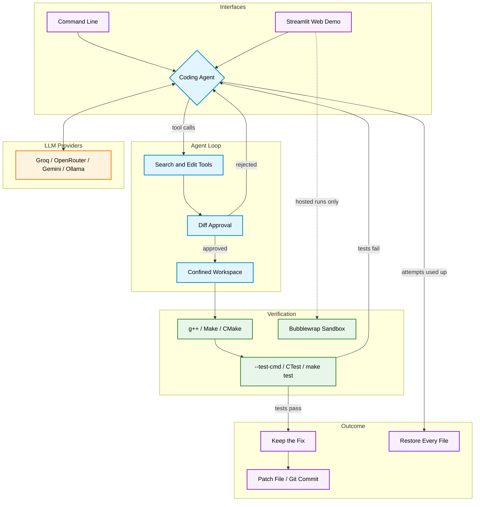

<div align="center">

# PatchPilot

**A command-line AI agent that takes a C++ bug described in plain English, fixes it with reviewable edits, and proves the result with your own build and tests.**

[](https://www.python.org/)
[](https://isocpp.org/)
[](https://groq.com/)
[](https://streamlit.io/)
[](https://docs.pytest.org/)
[](https://github.com/Shashank17singh/PatchPilot/actions/workflows/ci.yml)

</div>

---

## Overview

PatchPilot repairs small bugs in C and C++ projects. You describe the problem in ordinary language, and an LLM works through a small set of tools to find the code, read it and change it. Every edit appears as a diff and waits for your approval. Afterwards PatchPilot builds the project with g++, Make or CMake and runs your tests, so the agent can check its own fix and feed any failure into the next attempt. If no attempt succeeds, every file goes back exactly as it was.

It works with Groq, OpenRouter, Gemini and local models through Ollama. A benchmark of ten seeded bugs measures how well each model does, and a confirmed fix can be exported as a patch or committed to git.

> **The model proposes, your tests and your approval decide.**

---

## Architecture Overview



---

## Features

| Component                  | Description                                                                                                                                                                      |
| -------------------------- | -------------------------------------------------------------------------------------------------------------------------------------------------------------------------------- |
| **Edit Approval**          | Each proposed edit is shown as a full unified diff and needs a `y` before it is written. Any other answer, including closed input, refuses it. `--yes` skips the question.       |
| **Multi-Line Editing**     | `replace_range`, `insert_lines` and `delete_lines` join `replace_line`, so the model can add a missing brace or rewrite a block. CRLF endings and final newlines are preserved.  |
| **Pluggable Verification** | Detects CMake and Make projects, or uses plain g++. `--test-cmd`, CTest and `make test` let the agent judge its own fix instead of asking you.                                   |
| **Baseline Check**         | Tests run once before any edit. If they already pass they cannot prove a fix, so PatchPilot says so and asks you. If they fail, the output goes to the model as a starting point. |
| **Automatic Rollback**     | Failed, interrupted or crashed runs restore every file byte for byte.                                                                                                            |
| **Four LLM Providers**     | Groq, OpenRouter, Gemini and Ollama behind one `LLMClient` protocol, including the Gemini thought signatures that its tool calling requires.                                     |
| **Benchmark Suite**        | Ten seeded bugs, each judged by a hidden test the model cannot see or edit. Reports success rate, tokens, calls and time per model.                                              |
| **Git Integration**        | `--patch-file` writes a patch that `git apply` accepts. `--commit` commits only the fixed files and refuses if they held uncommitted work of yours.                              |
| **Web Demo**               | A Streamlit page where visitors bring their own API key. Code runs only inside a Bubblewrap sandbox, and without a working sandbox nothing runs at all.                          |

---

## Technology Stack

| Component            | Technologies                                                   |
| :------------------- | :------------------------------------------------------------- |
| **Language**         | Python 3.10+, targeting C and C++ projects                     |
| **LLM Inference**    | `groq`, `openai` (for OpenRouter, Gemini and Ollama)           |
| **Default Model**    | `openai/gpt-oss-120b` on Groq                                  |
| **Build and Test**   | `g++`, `make`, `cmake`, `ctest`, any shell command             |
| **Version Control**  | `git`, unified diffs with `difflib`                            |
| **Web Interface**    | `Streamlit`                                                    |
| **Sandboxing**       | `bubblewrap`, `prlimit`                                        |
| **Testing**          | `Pytest`, Streamlit `AppTest`, `httpx` mock transport          |
| **Quality & CI**     | `Ruff`, `Mypy` (strict), GitHub Actions                        |
| **Packaging**        | `uv`, `hatchling`, `Docker`                                    |

---

## Project Structure

```text
PatchPilot/
├── src/patchpilot/
│   ├── __init__.py             # Package version
│   ├── __main__.py             # python -m patchpilot entry point
│   ├── agent.py                # Attempt loop, approval, verdicts, rollback
│   ├── benchmark.py            # Benchmark runner and report (patchpilot-bench)
│   ├── cli.py                  # Flags, configuration, patch and commit output
│   ├── config.py               # Providers and settings from the environment
│   ├── diffs.py                # Unified diffs that git apply accepts
│   ├── errors.py               # Exception hierarchy with exit codes
│   ├── gitops.py               # Local commits that leave other work alone
│   ├── llm.py                  # LLMClient protocol and provider clients
│   ├── prompts.py              # System prompt and feedback messages
│   ├── sandbox.py              # Bubblewrap compile-and-run for hosted use
│   ├── tools.py                # Model-facing search and edit tools
│   ├── ui.py                   # Terminal input and output
│   ├── verifier.py             # g++, Make, CMake and test command verifiers
│   ├── web.py                  # Web demo logic, free of Streamlit
│   └── workspace.py            # Confined file access, snapshots and restore
├── webapp/
│   ├── app.py                  # Streamlit page
│   ├── requirements.txt        # Python dependencies for Community Cloud
│   └── packages.txt            # g++ and bubblewrap for Community Cloud
├── benchmarks/
│   ├── cases/                  # Ten seeded bugs with hidden tests
│   └── results/                # Saved benchmark reports
├── examples/cpp_demo/          # A correct C++ program to practise on
├── tests/                      # Unit and end-to-end tests (no network needed)
├── .github/workflows/ci.yml    # Lint, types and tests on push
├── .env.example                # Environment variable template
├── Dockerfile                  # Container with the C++ toolchain
├── LICENSE                     # MIT
├── pyproject.toml              # Project metadata and tooling
└── uv.lock                     # Locked dependencies
```

---

## Setup & Execution

### 1. Environment Initialization

```bash
git clone https://github.com/Shashank17singh/PatchPilot.git
cd PatchPilot
uv sync                          # or: python -m venv .venv && pip install -e .
```

You also need `g++` on your `PATH`. Without it PatchPilot still edits code but skips compiling.

### 2. Configure Environment Variables

Create your `.env` file and add a key for your provider (a free Groq key is available at [console.groq.com/keys](https://console.groq.com/keys)):

```bash
cp .env.example .env             # PowerShell: Copy-Item .env.example .env
```

```env
GROQ_API_KEY=your_api_key_here
```

### 3. Fix a Bug

PatchPilot edits files in place, so try it on a copy of the demo. Introduce a bug first, for example change `return a + b;` to `return a - b;`:

```bash
cp -r examples/cpp_demo /tmp/demo    # PowerShell: Copy-Item -Recurse examples\cpp_demo $env:TEMP\demo
uv run patchpilot /tmp/demo
```

PatchPilot lists the files it found and asks you to describe the bug. Every edit is then shown for approval:

```text
[step 3] TOOL CALLED -> replace_line
           args: {'path': 'main.cpp', 'line_number': 25, 'new_line': 'return a + b;'}
           proposed edit to main.cpp:
           | diff --git a/main.cpp b/main.cpp
           | --- a/main.cpp
           | +++ b/main.cpp
           | @@ -22,7 +22,7 @@
           |  }
           |
           |  int add(int a, int b) {
           | -    return a - b;
           | +    return a + b;
           |  }
           |
           |  // Returns n! for small non-negative n.
Apply this edit? (y/n): y
```

### 4. Let Tests Decide

Give PatchPilot a command that fails while the bug exists, and it will check its own work:

```bash
patchpilot my_project --test-cmd "./run_tests.sh"      # exit code 0 means fixed
patchpilot my_cmake_project                            # CMake detected, CTest runs by itself
patchpilot my_make_project                             # Make detected, runs a test or check target
patchpilot my_project --build none --test-cmd "make check"
```

`--build` accepts `auto`, `g++`, `make`, `cmake` or `none`. With a test command and no build system, the test command alone is used, since it has to build the code itself. CMake builds go to `.patchpilot-build/` inside the project, which ignores itself in git, so `ctest --test-dir .patchpilot-build` works as a test command.

### 5. Choose a Provider

```bash
patchpilot my_project --provider gemini
patchpilot my_project --provider openrouter --model openai/gpt-oss-120b
patchpilot my_project --provider ollama --model gpt-oss:20b    # local, needs no key
```

### 6. Keep the Fix

```bash
patchpilot my_project --patch-file fix.patch    # then: git apply fix.patch
patchpilot my_project --commit                  # commits locally, never pushes
```

`--commit` commits only the files the fix changed. If one of them already held uncommitted work, PatchPilot leaves the fix in your working tree and does not commit, so your changes never end up in its commit.

### 7. Run the Benchmark

```bash
uv run patchpilot-bench --models groq
uv run patchpilot-bench --models groq,gemini,ollama:gpt-oss:20b --repeat 3
uv run patchpilot-bench --models groq --only missing_brace,header_bug
```

Run it from the repository root. Reports are saved to `benchmarks/results/`.

### 8. Run the Web Demo

```bash
uv sync --extra web
uv run streamlit run webapp/app.py
```

### 9. Run Tests and Quality Checks

```bash
uv sync --all-extras
uv run pytest                    # uses a scripted model, so no API key or network is needed
uv run ruff check . && uv run ruff format --check .
uv run mypy
```

Tests that need `g++`, `make`, `cmake` or a working Bubblewrap are skipped when those are missing.

### Exit Codes

| Code | Meaning                                                    |
| ---- | ---------------------------------------------------------- |
| 0    | Bug fixed, or nothing to do                                |
| 1    | Bug not fixed, or a runtime failure (such as an API error) |
| 2    | Invalid configuration or workspace                         |
| 130  | Interrupted with Ctrl+C                                    |

---

## Configuration

Settings come from environment variables, or from a `.env` file in the current directory or any parent directory. Command-line flags take precedence.

| Variable                     | Default                     | Purpose                                                      |
| ---------------------------- | --------------------------- | ------------------------------------------------------------ |
| `PATCHPILOT_PROVIDER`        | `groq`                      | `groq`, `openrouter`, `gemini` or `ollama`                   |
| `GROQ_API_KEY`               | none                        | Key for Groq                                                 |
| `OPENROUTER_API_KEY`         | none                        | Key for OpenRouter                                           |
| `GEMINI_API_KEY`             | none                        | Key for Gemini                                               |
| `OLLAMA_BASE_URL`            | `http://localhost:11434/v1` | Address of your Ollama server                                |
| `PATCHPILOT_MODEL`           | the provider's default      | Model identifier                                             |
| `PATCHPILOT_MAX_ATTEMPTS`    | `3`                         | Fix attempts before giving up and rolling back               |
| `PATCHPILOT_MAX_STEPS`       | `10`                        | Tool-calling steps allowed per attempt                       |
| `PATCHPILOT_RUN_TIMEOUT`     | `10`                        | Seconds the compiled program may run during verification     |
| `PATCHPILOT_COMMAND_TIMEOUT` | `300`                       | Seconds each Make, CMake or test command may run             |
| `PATCHPILOT_LOG_LEVEL`       | `WARNING`                   | Diagnostic logging on stderr (`DEBUG`, `INFO`, ...)          |

Default models are `openai/gpt-oss-120b` on Groq and OpenRouter, `gemini-3.8-flash` on Gemini and `gpt-oss:20b` on Ollama.

---

## Deployment

### Docker

The image bundles g++, Make, CMake and git, so the host needs only Docker. Mount your project at `/workspace`. `-it` is required because PatchPilot prompts interactively.

```bash
docker build -t patchpilot .
docker run --rm -it \
  --env-file .env \
  --user "$(id -u):$(id -g)" \
  -v "$PWD/my_cpp_project:/workspace" \
  patchpilot
```

### Streamlit Community Cloud

1. Open [share.streamlit.io](https://share.streamlit.io) and choose **Create app** → **From existing repo**.
2. Select your repository, branch `main` and main file path `webapp/app.py`.
3. Click **Deploy**. Dependencies install from `webapp/requirements.txt` and `webapp/packages.txt`.

No secrets are needed, because visitors enter their own API key. It is kept in the browser session and never stored. The sidebar shows whether the sandbox is active. If the platform does not allow Bubblewrap, the demo stays online in edit-only mode: it proposes a diff and compiles nothing.

---

## Benchmark Results

No results are published yet. Scores depend heavily on the model, so run the suite yourself:

```bash
uv run patchpilot-bench --models groq --repeat 3
```

Each of the ten cases gets up to 3 attempts of 10 steps, and only its hidden test decides success. The Markdown report in `benchmarks/results/` gives the success rate, average tokens, LLM calls and time for each model, plus a pass count per case. `tests/test_benchmark.py` proves that every seeded bug fails its hidden test and that its reference fix passes, with no model involved.

---

## Security Notes

**What PatchPilot protects.**

- The model can only read and edit `.c`, `.cc`, `.cpp`, `.h` and `.hpp` files inside the project. Paths that escape it (`../`, absolute paths, symlinks pointing outside) and directories such as `.git`, `.venv` and `build` are refused.
- Nothing is written without your approval unless you pass `--yes`. Closed input counts as a refusal.
- Every code file is snapshotted before the first edit and restored if all attempts fail, if you press Ctrl+C, or if the API fails mid-run.
- `--commit` never pushes, and never sweeps your uncommitted work into its commit.

**What it does not protect on your machine.**

- The command line **compiles and runs model-written code with your user's permissions**, and so do your Make, CMake and test commands. Run time is limited, but this is not sandboxed. Read the diffs, avoid `--yes` on code you do not trust, and use Docker for untrusted projects.
- Your source code goes to your LLM provider as part of the conversation, unless you use Ollama. Do not point PatchPilot at code you are not allowed to share.

**The hosted web demo.**

- Compiling and running both happen inside Bubblewrap, because compiling is not safe either: `#include "/proc/self/environ"` could put server secrets into compiler errors.
- The sandbox has no network, no capabilities, an empty environment and its own PID namespace. CPU time, memory, file size and process count are capped, and output is size-limited.
- `sandbox_available()` starts a real sandboxed compiler rather than looking for the binary. If that fails, the demo compiles and runs nothing. There is no fallback to unsandboxed execution.
- Run limits are per browser session, so they slow down casual misuse and nothing more. Bubblewrap also shares the host kernel, which makes it weaker than a virtual machine.

---

## Limitations

- It supports C and C++ only, and the agent cannot create new files.
- `g++` mode compiles every `.cpp` and `.cc` file together, with no flags or libraries. Use Make, CMake or `--test-cmd` for anything more involved.
- Without automated tests, whether a bug is fixed is judged by you reading the program output.
- The agent does not see `Makefile` or `CMakeLists.txt` contents and cannot edit them, so build configuration bugs are out of reach.
- Small, well-described bugs work best, and quality depends heavily on the model.

---

## Deep Codebase Analysis

| File                           | Purpose / Details                                                                                                   |
| ------------------------------ | ------------------------------------------------------------------------------------------------------------------- |
| `src/patchpilot/agent.py`      | Runs the baseline check, attempt cycles and tool loop; shows diffs for approval; decides verdicts; rolls back.      |
| `src/patchpilot/benchmark.py`  | Loads cases, runs each on a private copy, judges with the hidden test, writes JSON and Markdown reports.            |
| `src/patchpilot/cli.py`        | Parses flags, validates configuration before prompting, and exports or commits a confirmed fix.                     |
| `src/patchpilot/config.py`     | Provider table and immutable settings read from the environment.                                                    |
| `src/patchpilot/diffs.py`      | Builds unified diffs that preserve CRLF and missing final newlines, so `git apply` reproduces exact bytes.           |
| `src/patchpilot/errors.py`     | Exception hierarchy where each error carries its exit code.                                                         |
| `src/patchpilot/gitops.py`     | Finds uncommitted files, commits named paths only, and builds commit messages.                                      |
| `src/patchpilot/llm.py`        | `LLMClient` protocol, Groq and OpenAI-compatible clients, and replay of Gemini and OpenRouter provider data.        |
| `src/patchpilot/prompts.py`    | System prompt and the feedback sent after build failures, test failures and rejected fixes.                         |
| `src/patchpilot/sandbox.py`    | Bubblewrap command construction, the live availability probe and the sandboxed verifier.                            |
| `src/patchpilot/tools.py`      | Six model-facing tools, tool schemas, line-ending handling and the approval gate every edit passes through.         |
| `src/patchpilot/ui.py`         | `UserInterface` protocol and the terminal implementation.                                                           |
| `src/patchpilot/verifier.py`   | g++, Make, CMake and test command verifiers, process-tree timeouts and build system detection.                      |
| `src/patchpilot/web.py`        | Upload validation, limited settings, expected-output checks and the throwaway run behind the web demo.              |
| `src/patchpilot/workspace.py`  | Path confinement, line-preserving reads and writes, snapshots, restore and diffs.                                   |
| `webapp/app.py`                | Streamlit page: demo, paste or upload input, bring-your-own key, live log, diff and patch download.                 |
| `benchmarks/cases/`            | Ten bugs covering logic, types, syntax, state, hangs and multi-file fixes, each with a reference fix.               |
| `examples/cpp_demo/main.cpp`   | A correct program that prints each result beside its expected value.                                                |
| `tests/test_agent.py`          | Agent loop, feedback, rollback and model misbehaviour, driven by a scripted model.                                  |
| `tests/test_agent_features.py` | Edit approval, automated verdicts, baseline checks and provider data replay.                                        |
| `tests/test_app.py`            | Headless Streamlit `AppTest` scenarios.                                                                             |
| `tests/test_benchmark.py`      | Proves every case fails before its reference fix and passes after, plus scoring and reports.                        |
| `tests/test_build_systems.py`  | Build detection, process-tree timeouts, and real Make, CMake and CTest runs.                                        |
| `tests/test_git.py`            | Checks exported patches with real `git apply` and commit safety with real repositories.                            |
| `tests/test_llm.py`            | Runs the real SDK against a mock HTTP transport, including the thought signature round trip.                        |
| `tests/test_multiline_tools.py` | Multi-line edits, line endings, invalid ranges and approval on every edit tool.                                    |
| `tests/test_sandbox.py`        | Sandbox command checks, plus real isolation tests for secrets, files, network and runaway output.                   |
| `tests/test_web.py`            | Upload validation, the no-sandbox guarantee and web run behaviour.                                                  |
| `.github/workflows/ci.yml`     | Runs Ruff, Mypy and Pytest on Python 3.10 to 3.13, and fails if the sandbox tests cannot run.                       |
| `Dockerfile` / `.dockerignore` | Slim Python image with the C++ toolchain, running as a non-root user.                                               |
| `pyproject.toml` / `uv.lock`   | Project metadata, console scripts, extras, tool configuration and locked dependencies.                              |

---

## License

This project is licensed under the [MIT License](LICENSE).
